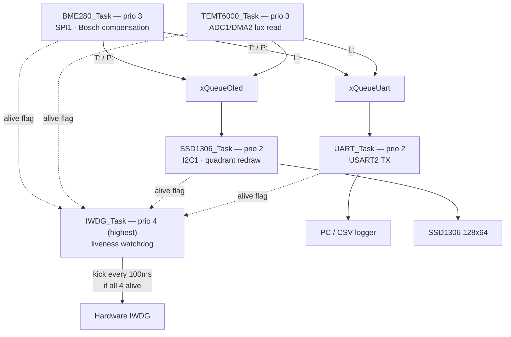

# STM32-WeatherStation

Embedded C project on an **STM32F446** (Cortex-M4) — **100% bare-metal register-level**, FreeRTOS, no HAL, no CubeMX.

Reads temperature, humidity, pressure and ambient light, displays them on an OLED, streams them over UART for PC-side logging, and watches its own five tasks with a software watchdog layered on top of the hardware IWDG.

---

## Example


## What it does

| Feature | Description |
|---------|-------------|
| Multi-sensor acquisition | BME280 (T/H/P) over SPI, TEMT6000 (lux) over ADC/DMA |
| OLED display | 128×64 SSD1306 over I2C, 4-quadrant live readout |
| Flicker-free redraw | Each field's region cleared with a fixed rectangle before redraw — no full-screen flicker, no leftover digits |
| UART telemetry | Plain-text frames (`T:23.45`, `P:1013`, `H:45.2`, `L:320`) ready for CSV logging on a PC |
| Software watchdog | Per-task heartbeat flags, independently timed out and logged, gate the hardware IWDG kick |
| Hardware watchdog | IWDG armed for a ~8.2s timeout, only kicked once all 5 tasks have checked in |
| Register-level everything | RCC, GPIO, SPI, I2C, ADC, DMA, IWDG, USART all configured by hand from the datasheet, no ST HAL |
| Measured stack sizing | Every task profiled with `uxTaskGetStackHighWaterMark()`, sized with margin |

---

## Hardware

| Peripheral | Interface | Role |
|------------|-----------|------|
| BME280 | SPI1 | Temperature, humidity, pressure |
| TEMT6000 | ADC1 (DMA2, continuous) | Ambient light |
| SSD1306 | I2C1 | 128×64 OLED live display |
| PC link | USART2 | Text telemetry for logging |
| IWDG | — | Hardware last-resort watchdog |

---

## File structure

```
Core/
├── BSP/                       # Bare-metal register-level peripheral drivers
│   ├── rcc/                   # rcc.h / rcc.c        — clock enables
│   ├── gpio/                  # gpio.h / gpio.c       — pin config (SPI/I2C/USART/ADC)
│   ├── spi/                   # spi.h / spi.c         — SPI1 master (BME280)
│   ├── i2c/                   # i2c.h / i2c.c         — I2C1 master (SSD1306)
│   ├── adc/                   # adc.h / adc.c         — ADC1 (TEMT6000)
│   ├── dma/                   # dma.h / dma.c         — DMA2 (ADC1 stream)
│   └── iwdg/                  # iwdg.h / iwdg.c       — hardware watchdog
│
├── App/
│   ├── Modules/
│   │   ├── BME280/            # bme280.h / bme280.c   — driver + Bosch compensation
│   │   └── SSD1306/           # ssd1306.h / ssd1306.c — display lib, ported off HAL
│   │
│   ├── Tasks/
│   │   ├── BME280_Task/       # reads + publishes T/P/H
│   │   ├── TEMT6000_Task/     # reads + publishes lux
│   │   ├── SSD1306_Task/      # renders queued values to the OLED
│   │   ├── UART_Task/         # streams queued values to the PC
│   │   └── IWDG_Task/         # per-task liveness watchdog
│   │
│   ├── globals.h / globals.c  # shared queues + task-alive flags
│
└── main.c                     # peripheral bring-up, queue/task creation, scheduler start
```

---

## Data output

```
T:23.45
P:1013
H:45.20
L:320
```

Streamed continuously over USART2, one frame per reading, designed to be piped straight into a CSV logger for post-processing and plotting on a PC.

---

## Architecture

Five FreeRTOS tasks, two queues, zero shared memory outside `globals.c` (accessed only through `volatile` flags or queues).



### Task priority map

| Task | Priority | Role |
|------|----------|------|
| `IWDG_Task` | 4 — highest | Can't be starved by a peripheral task blocked on I2C/SPI |
| `BME280_Task` | 3 | SPI acquisition + compensation |
| `TEMT6000_Task` | 3 | ADC/DMA acquisition |
| `SSD1306_Task` | 2 | Display refresh |
| `UART_Task` | 2 | Telemetry streaming |

---

## Key design decisions

**Register-level, on purpose** — RCC, GPIO, SPI, I2C, ADC, DMA, IWDG and USART are all configured directly from the reference manual, no HAL, no CubeMX. The only external code is Bosch's BME280 compensation formulas and the SSD1306 display library, which was stripped of its HAL dependencies and ported onto the project's own bare-metal I2C driver.

**Watchdog is two-layered** — `IWDG_Task` tracks a per-task "alive" flag and independently times out each of the four other tasks (logging a warning over UART on timeout). The hardware IWDG is only kicked when *all four* have checked in, so a single stuck task still triggers a full reset even if the others are healthy. This layer catches task freeze/starvation; it doesn't validate sensor data, which is a deliberately separate concern.

**Flicker-free display** — instead of clearing the whole 128×64 buffer every frame, each field owns a fixed rectangle that's cleared before its new value is written. Solves the classic "leftover digit" artifact when a value shrinks (e.g. `123` → `12`) without the flicker of a full-screen wipe.

**Stack sizing, measured not guessed** — every task was created with 256 words and profiled with `uxTaskGetStackHighWaterMark()` under real load:

| Task | Free (words) | Used (words) |
|------|---------------|---------------|
| `BME280_Task` | 96 | 160 |
| `TEMT6000_Task` | 118 | 138 |
| `UART_Task` | 118 | 138 |
| `SSD1306_Task` | 108 | 148 |
| `IWDG_Task` | 130 | 126 |

256 words was kept as a uniform, deliberately generous allocation across all five tasks rather than trimmed per-task — simpler to maintain, and RAM headroom on the F446 isn't the bottleneck here.

**CSV over JSON** — the UART frame format is a flat `KEY:VALUE` text line by design, so the PC-side pipeline (a C++ logger, then Python for stats/plots) can timestamp and append straight to CSV without a parsing layer.
